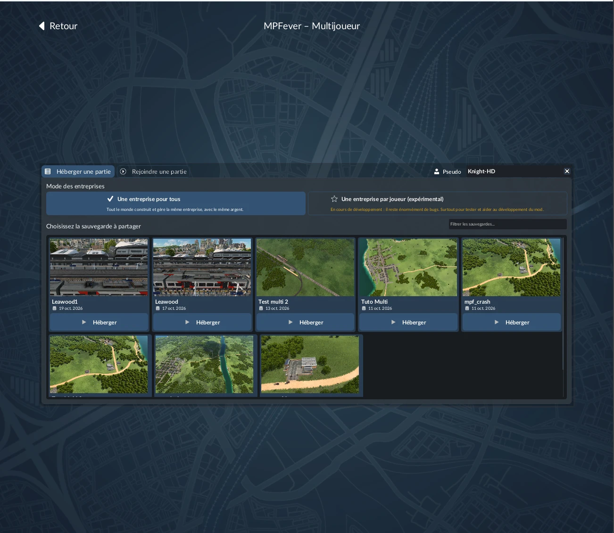
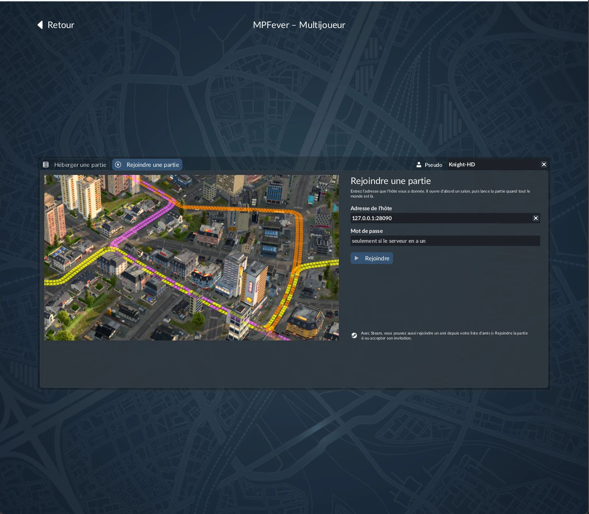
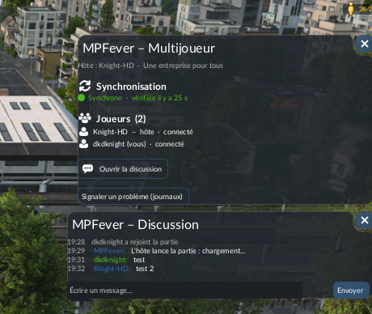

# MPFever – Multiplayer for Transport Fever 3

**Play Transport Fever 3 with your friends, in the same world, over the internet or a local network.**

[](https://github.com/dkdknight/MPFever/releases/latest)
[](https://www.nexusmods.com/transportfever3/mods/4)
[](https://ko-fi.com/knighthd)



Each player plays in their own copy of the game. MPFever replays every player's actions in every game at the same moment, checks that the games stay identical, and repairs them by itself when they don't.

> **MPFever is still in active development.** Most sessions run for hours, but desyncs still happen. **Back up your savegames**, and please [report problems](#reporting-a-problem) with your logs: every report helps.

---

## Contents

- [Before you start](#before-you-start)
- [Install and play](#install-and-play)
- [What you can do](#what-you-can-do)
- [Mods](#mods)
- [Known limitations](#known-limitations)
- [Troubleshooting](#troubleshooting)
- [Reporting a problem](#reporting-a-problem)
- [For developers](#for-developers)
- [Credits and support](#credits-and-support)

---

## Before you start

| Requirement | Why |
|---|---|
| **Transport Fever 3 on Steam, Windows** | MPFever is tested on the Steam version only. Other stores (Epic...) are not supported yet. |
| **The same game version on every PC** | Two different game builds don't simulate the world the same way. Supported: **40423** (current) and **40420**. Make sure Steam has updated the game on every PC. |
| **The same MPFever version on every PC** | MPFever updates itself; every player just needs a recent version (0.3.15 or later). |
| **The same mods, in the same version** | MPFever checks it in the lobby, installs the missing ones from the game's Mod Hub and tells you what to fix. Mods that only change your interface may differ. |

## Install and play

1. Download **`MPFever-<version>.zip`** from the [releases](https://github.com/dkdknight/MPFever/releases/latest).
2. **Extract the whole folder** anywhere, for example on your desktop.
   Always start `MPFever.exe` **from that folder**. Don't move the `.exe` out of it, use a shortcut instead: MPFever needs the files next to it to update itself and to stay in sync.
3. Start **`MPFever.exe`**. It finds the game, installs the mod and starts Transport Fever 3.
4. In the main menu, click the **Multiplayer** card (top left).
   - **The host** clicks **Host** under one of their savegames to open a lobby.
   - **The others** join the host's address, or accept the host's Steam invitation.
5. When everybody is in the lobby, the host clicks **Start the game**. Every game loads the host's world at the same time.



Players can also join a game already running, and a lost connection reconnects by itself.

**Ports:** most of the time there is nothing to do. MPFever opens the host's port (28090, TCP) on the router by itself. If it can't (some providers share one address between customers), the launcher's log says so: forward the port by hand, use IPv6, or use a dedicated server. Details: [INSTALL](docs/INSTALL.txt).

## What you can do

### Two ways to play, chosen by the host

- **One company for everybody** (co-op): shared money, vehicles and lines.
- **One company per player**: each player has their own money, network, vehicles, lines, loans, contracts and Company window.
  - Each player picks their company's colour in the lobby; the map's icons show who owns what.
  - What belongs to another company can't be sold, edited or used.
  - Tracks, stations and depots are open to the other companies by default. Each company sets its rules in the MPFever window: private, open, or with a toll (per passage, per stop, per vehicle).
  - Several players can run one company together: ask to join another company (its chief accepts), leave yours, or merge two companies.
  - A company in debt for too long (3 to 24 months, set by the host in the lobby) goes bankrupt: its lines, stations and depots are auctioned to the others, and its players start again.
  - Fees and tolls show in the finance window. Companies can give each other money, and the MPFever window ranks them.

### Everything is replicated

- Roads, tracks, trams, signals, stops, stations, depots and buildings.
- Terrain edits, trees and the bulldozer.
- Vehicles, lines, game speed and pause.
- Demolishing what you just built gives the money back, as in a solo game.
- What another player's tool shows before their click (a road, a track, a station) shows on the ground in your game, in their colour. The host can turn it off.
- The host's game reaches each player by itself, and after a reload only what changed is sent (about a tenth of the savegame). A player who already has the host's savegame downloads nothing.

### In-game tools

The MPFever card in the pause menu opens:

- **the MPFever window:** the players, their connection, the sync state, Steam invites, and the **Report a problem** button;
- **the chat:** new messages show for a few seconds on the left of the screen.



### Repairs itself

- The games compare their state every 10 seconds, and money is corrected at once.
- A lasting difference reloads the host's world for everybody, in about 20 seconds.

### Dedicated server

A PC of its own can run the world without anybody playing on it: download **`MPFever-<version>-server.zip`** and start `MPFever.exe --server`. It includes:

- a password and a player limit;
- autosaves with backups;
- a restart after a crash;
- a console.

See [SERVER](docs/SERVER.txt).

### And also

- Automatic updates of MPFever.
- Smooth game speed between players.
- The 13 languages of the game.

## Mods

**Every player needs the same mods, in the same version**, except the personal ones (below). When you join, the lobby lists what to fix: mods missing on your PC, in another version than the host's, or known to break a session. The host's world isn't loaded until it's fixed.

- **Missing mods install by themselves:** the game's own Mod Hub (mod.io, Steam Workshop) subscribes you to them and downloads them. Sign in to the Mod Hub first (Mods button of the main menu). It can be turned off in ⚙ Settings.
- **The host's local mods** (on no Mod Hub): the host is asked whether to send them from their PC, with their size, and you choose whether to take them. Only accept from a host you trust: a mod holds code that runs in your game.
- **Personal mods:** a mod that only changes your interface (windows, overlays, icons, styles) can be yours alone. The lobby shows which mods are personal; yours are added to the host's world on your PC only. You can also play without a missing mod by taking it for personal, at the risk of a desync if it does more than the interface.

| Kind of mod | Works? |
|---|---|
| **Content** (vehicles, buildings, streets, textures...), interface, game data | ✅ When every player has the same version. |
| **Mods that name, colour or assign lines by themselves** (*Auto Line Namer*, *Auto Color Lines*, *Auto Assign Terminals*...) | ✅ Only the host's game makes the changes, shared with everybody. |
| **Other mods with a script that changes the game by itself** | ⚠️ Shown as « untested script ». They may make the games drift apart. |
| **Other multiplayer mods** | ❌ Incompatible: turn them off. |

The mods tested so far are listed in [MODS](docs/MODS.md).

**Mod authors:** if your mod breaks a session, open an [issue](https://github.com/dkdknight/MPFever/issues). We can work together on a simple way for your mod to know it runs in MPFever and to act on the host only.

## Known limitations

- **One company per player:** a merger into the savegame's company leaves the merged company's loans behind (they are the game's own loans).
- **Steam and Windows only.**
- **Small drifts of vehicles and passengers** can happen. They are repaired by a reload if they last.

What's planned: [ROADMAP](docs/ROADMAP.txt). What changed: [CHANGELOG](docs/CHANGELOG.txt).

## Troubleshooting

| Problem | What to do |
|---|---|
| Resyncs every few minutes, even without building anything | Check that every player has the **same game build**: it's written at the top of each report and in the host's launcher log (« game ready ... build »). Update the game in Steam (*Properties → Installed Files → Verify integrity*). |
| The launcher's log says « MPFever.exe is not in a version folder » or « winhttp.dll missing » | `MPFever.exe` was started outside its folder. Extract the whole zip again and start it from there. |
| « Savegame not found » when hosting | Update to 0.4.1 or later. |
| The guest can't connect | Check the port (above), or try the host's IPv6 address shown in the launcher. |
| A « (different mods) » player in the lobby | That player must install or update the listed mods, then join again. |

## Reporting a problem

Open an [issue](https://github.com/dkdknight/MPFever/issues) with your logs. **Without logs, a desync or a crash can rarely be found.** With them, most bugs are fixed in the next version.

1. **Click « Report a problem »:** in the MPFever window of the game, or in the launcher. MPFever zips every log, shows the zip and opens an issue already filled in. After a crash, it offers it by itself. Your Windows account and PC names, Steam account numbers and public IP address are taken out of the logs.
2. **Say what you did just before, and when** (your clock): built a station, bulldozed a road... Say who was the host.
3. **Ask every player to send theirs**, the host's above all.
4. **The savegame helps a lot.** With it, we can replay the problem here. It's usually over 25 MB: share it through Google Drive, Dropbox or WeTransfer. After a resync, add `MPFever resync.sav` too.

The savegames are in `Steam\userdata\<number>\3493540\local\save\`.

---

## For developers

### How it works

| Part | Folder | Role |
|---|---|---|
| Launcher | `launcher/` (C#, .NET Framework 4.8) | Hosts or joins over TCP, starts the game, installs the mod and the native module. It relays actions, compares the games' state and runs the resyncs. With `--server`, it is the dedicated server. |
| Game mod | `mod/mpfever_1/` (Lua) | Captures player actions and replays them in every game at the same game time (barrier lockstep). It computes the state checksums and manages the companies. It also draws the multiplayer page and the in-game windows. It does nothing unless the game was started by the launcher. |
| Native module | `native/` (C++, no CRT) | `winhttp.dll` in the game folder, a pass-through proxy. In a session, it holds construction commands until the shared step, copies terrain edits, separates each player's company, and fixes the game's sources of randomness and its pacing. |
| Tests | `tests/` (Python + lupa) | Language files and a simulated lockstep. |

The launcher and the game talk through files in `%TEMP%\mpfever\<session>\`. No process injection is used.

What we learned about the engine, the causes of desyncs and what each mode must synchronise is in [RESEARCH](docs/RESEARCH.md).

### Building

You need Windows 10/11 and Visual Studio 2022 or later, with *Desktop development with C++* and *.NET desktop development* (.NET Framework 4.8). Then run:

```bat
build.bat
```

It builds `native\out\winhttp.dll`, `launcher\bin\Release\MPFever.exe` and the archives in `release\`.

### Game updates and signatures

The native module finds the places it patches in the game's code by their signatures, in `mpfever_sigs.txt`, shipped next to `MPFever.exe`. A feature whose places are not all found stays off, and `native.log` says so.

After a game update, check which places the new build still has (needs `pip install pefile capstone`):

```bat
python tools\mksigs.py check "<path>\TransportFever3.exe"
```

### Tests

- `python tests\test_lang.py`: the language files.
- `MPFever.exe --selftest`: the relay, the client and the server settings, without the game.
- `MPFever.exe --autotest <savegame>`: two real games on one PC, with scenarios chosen by environment variables. See [RESEARCH](docs/RESEARCH.md).

---

## Credits and support

- **[dkdknight](https://github.com/dkdknight)**: author and maintainer.
- **[SlikerDev](https://github.com/SlikerDev)**:
  - dedicated server, automatic updates, IPv6;
  - the launcher's design;
  - the translations into 13 languages;
  - the in-game window and the chat.
- **[Steelworm](https://github.com/Steelworm)**: build timing fixes, the builder lead, in-depth issue analyses.
- **[Juliansgith](https://github.com/Juliansgith)**: several order fixes, the smooth pacing, the signatures and the company rules (MIT).
- **The testers** who sent reports, logs and savegames: most fixes came from them. Thank you to
  kingplay98, theop, simon21-la, Vogel, Alex, CrossCroissant, AZalshehri7, ArtemQa8, KatzenSupport, GreGNee, terpo,
  seksi1227-wq, Manocornuto, dev-andrei-v, Nassachi, Zippo1578, Shog-SC, thedevouttrout, AlexXY2, MorganJones13
  and everyone who played and gave feedback on Nexus.

MPFever is free and open source, under the [GNU General Public License v3](LICENSE) (GPL-3.0-or-later): you may use, study, change and share it, and a project that includes MPFever's code must be shared under the same license. Versions up to 0.4.5 were published under the MIT License and stay so; see [NOTICE.txt](NOTICE.txt). If you enjoy it, you can support its development on [Ko-fi](https://ko-fi.com/knighthd) or leave a comment on [Nexus](https://www.nexusmods.com/transportfever3/mods/4?tab=posts).

[](https://ko-fi.com/knighthd)

*MPFever is not affiliated with Urban Games. Transport Fever 3 is a trademark of its owners.*
